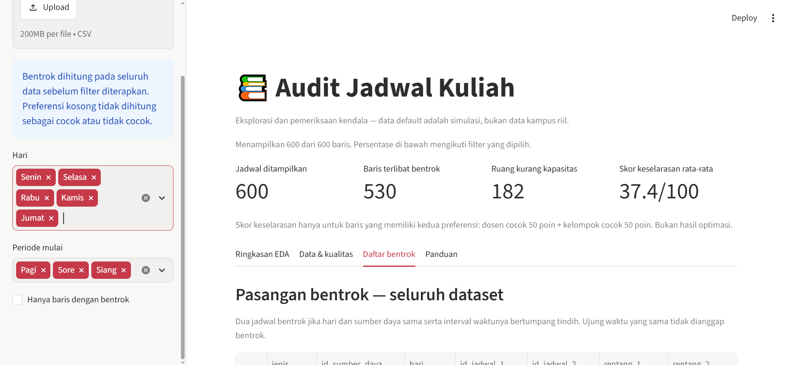
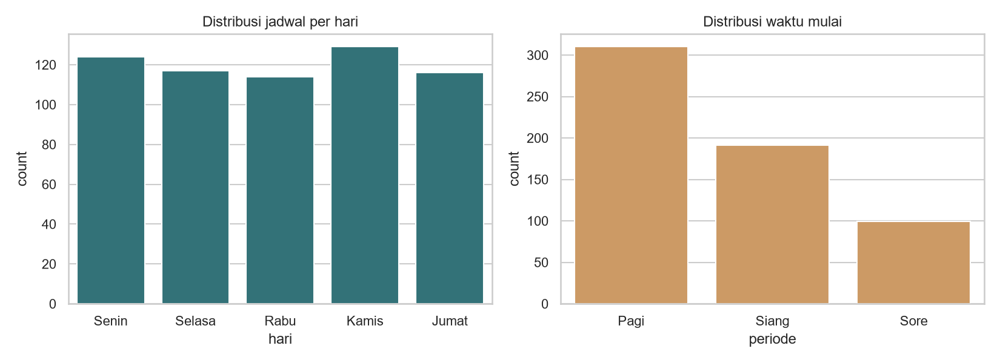
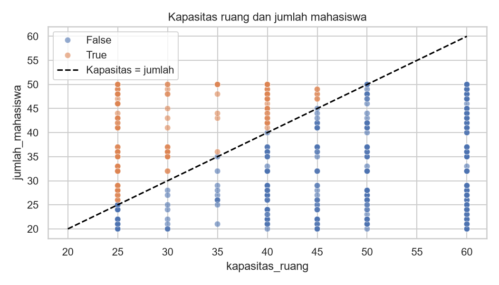
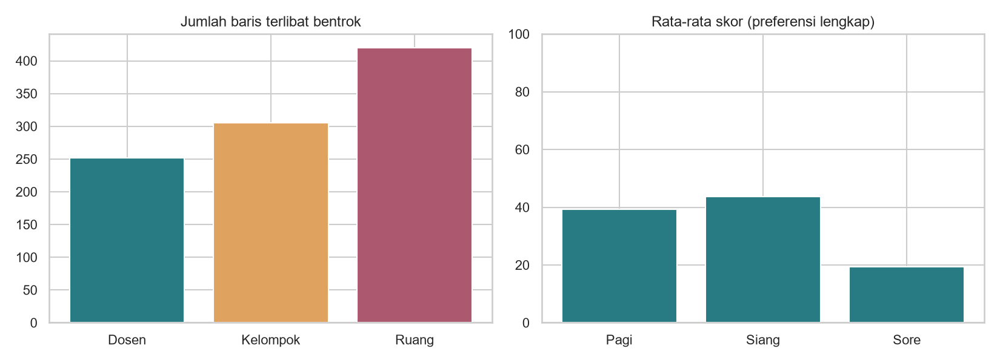
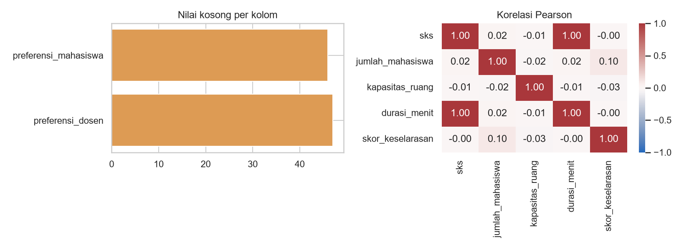

# Audit Jadwal Mata Kuliah

**Exploratory Data Analysis untuk Penjadwalan dengan Preferensi Dosen dan Mahasiswa**

_600 jadwal sintetis · Pemeriksaan bentrok & kapasitas · Analisis preferensi · Dashboard Streamlit_

[](https://www.python.org/)
[](https://streamlit.io/)
[](jadwal_eda/data/jadwal_dummy_600.csv)
[](jadwal_eda/Laporan_EDA_Penjadwalan_Matakuliah.pdf)
[](https://colab.research.google.com/github/Hily30/datascience-hilyah/blob/main/EDA_Penjadwalan_Colab.ipynb)

[Ringkasan](#ringkasan-proyek) · [Tampilan Aplikasi](#tampilan-aplikasi) · [Temuan EDA](#temuan-utama-eda) · [Grafik](#grafik-eda) · [Pengujian](#pengujian) · [Dokumen](#dokumen-proyek) · [Tutorial](#tutorial-menjalankan-aplikasi)

> [!IMPORTANT]
> Dataset dalam proyek ini **sepenuhnya sintetis** dan dibuat untuk simulasi. Angka di bawah bukan gambaran kondisi kampus tertentu. Aplikasi melakukan **audit dan eksplorasi jadwal**, belum melakukan optimasi atau menyusun jadwal baru.

---

## Ringkasan Proyek

Penjadwalan mata kuliah melibatkan dosen, kelompok mahasiswa, ruang, kapasitas, serta waktu. Jadwal yang belum diperiksa dapat menyebabkan **kelas bertabrakan**, kapasitas ruang tidak mencukupi, atau waktu kuliah tidak sesuai dengan preferensi.

Proyek ini menggunakan EDA untuk memahami kualitas data dan memetakan masalah tersebut sebelum tahap pengembangan algoritma optimasi.

| Komponen | Keterangan |
| :--- | :--- |
| **Objek penelitian** | Penjadwalan mata kuliah dengan preferensi dosen dan mahasiswa |
| **Unit analisis** | Satu pertemuan kelas dalam satu minggu simulasi |
| **Dataset** | 600 baris, 14 kolom awal; dibuat dengan Python |
| **Cakupan simulasi** | 18 mata kuliah, 72 dosen, 60 kelompok mahasiswa, 35 ruang |
| **Fokus audit** | Bentrok jadwal, kapasitas ruang, dan kecocokan preferensi |
| **Teknologi** | Python, pandas, NumPy, Matplotlib, seaborn, dan Streamlit |

> Preferensi mahasiswa dalam data dummy diwakili oleh **satu preferensi per kelompok**, bukan preferensi setiap mahasiswa secara individual.

---

## Tampilan Aplikasi



_Tangkapan layar contoh dari aplikasi pada tahap awal. Versi terbaru juga menampilkan total seluruh jadwal secara terpisah dari jadwal yang terfilter._

| Menu | Fungsi |
| :--- | :--- |
| **Ringkasan EDA** | Melihat distribusi jadwal dan kecocokan preferensi |
| **Data & kualitas** | Memeriksa nilai kosong, validitas, dan tabel data |
| **Daftar bentrok** | Melihat serta mengunduh pasangan jadwal yang bertabrakan |
| **Panduan** | Membaca fungsi dan batasan pemeriksaan |
| **Filter dan CSV** | Memilih hari/periode serta mengunggah data berformat sesuai contoh |

Aplikasi dijalankan di komputer menggunakan Streamlit; **belum tersedia tautan aplikasi online** dalam repository ini. Petunjuk menjalankan tersedia pada [bagian tutorial](#tutorial-menjalankan-aplikasi).

---

## Temuan Utama EDA

Hasil berikut berasal dari [dataset dummy](jadwal_eda/data/jadwal_dummy_600.csv) dan dihitung melalui [`analisis.py`](jadwal_eda/analisis.py).

| Indikator | Hasil simulasi | Interpretasi |
| :--- | ---: | :--- |
| **Jumlah data** | **600** jadwal | Semua jadwal diasumsikan dalam satu minggu |
| **Baris terlibat bentrok** | **530 / 600** (88,33%) | Setidaknya satu bentrok dosen, kelompok, atau ruang |
| **Kapasitas ruang kurang** | **182 / 600** (30,33%) | Jumlah mahasiswa melebihi kapasitas ruang |
| **Preferensi dosen cocok** | **38,52%** | 213 cocok dari 553 baris dengan preferensi dosen terisi |
| **Preferensi kelompok cocok** | **35,02%** | 194 cocok dari 554 baris dengan preferensi kelompok terisi |
| **Rata-rata skor gabungan** | **37,40 / 100** | Dihitung hanya dari 512 baris dengan kedua preferensi terisi |

Nilai bentrok yang tinggi disebabkan jadwal simulasi dibuat secara acak tanpa jaminan layak; angka tersebut **bukan hasil evaluasi universitas**.

### Rincian bentrok

| Sumber daya | Baris terlibat | Pasangan bentrok |
| :--- | ---: | ---: |
| Dosen | 252 | 161 |
| Kelompok mahasiswa | 305 | 211 |
| Ruang | 420 | 377 |

**Cara membaca:** satu baris dapat terlibat lebih dari satu jenis bentrok, sehingga angka tiap jenis tidak dijumlahkan sebagai baris unik. Pasangan bentrok diperiksa berdasarkan hari, sumber daya, dan interval waktu yang beririsan. Jadwal yang mulai tepat saat jadwal lain selesai tidak dianggap bentrok.

### Kualitas data dan preferensi

- **47 baris** memiliki preferensi dosen kosong; **46 baris** memiliki preferensi kelompok kosong.
- Terdapat **0 duplikat baris penuh**, **0 waktu invalid**, dan **0 durasi tidak sesuai** asumsi data.
- Preferensi kosong dianggap **tidak diketahui**, bukan otomatis tidak cocok.
- Skor gabungan menggunakan asumsi **50 poin untuk kecocokan dosen + 50 poin untuk kecocokan kelompok**. Skor hanya dihitung bila kedua preferensi tersedia.
- Sebanyak **27 jadwal 2 SKS** terdeteksi sebagai pencilan statistik tetapi dipertahankan karena valid menurut rancangan data.

---

## Grafik EDA

| Distribusi Hari dan Periode | Jumlah Mahasiswa dan Kapasitas |
| :---: | :---: |
|  |  |

| Bentrok dan Preferensi | Nilai Hilang dan Korelasi |
| :---: | :---: |
|  |  |

Seluruh grafik tersedia pada folder [`jadwal_eda/grafik`](jadwal_eda/grafik/). Korelasi SKS dan durasi bernilai 1 karena durasi dihitung dari rumus **50 × SKS**; ini adalah hubungan akibat desain data, bukan bukti sebab-akibat.

---

## Alur dan Metode

```text
Data jadwal sintetis (CSV)
            │
            ▼
   Pemuatan dan pemeriksaan data
   • struktur, duplikat, nilai kosong
            │
            ▼
   Eksplorasi dan visualisasi EDA
   • distribusi, pencilan, korelasi
            │
            ▼
   Audit kendala dan preferensi
   • bentrok, kapasitas, kecocokan
            │
            ▼
   Dashboard, laporan, dan rekomendasi
```

**Asumsi waktu:** satu SKS = 50 menit; periode ditentukan dari waktu mulai: Pagi sebelum 12.00, Siang 12.00–14.59, dan Sore mulai 15.00. Asumsi tersebut perlu disesuaikan dengan kebijakan institusi jika data nyata digunakan.

---

## Pengujian

Pengujian yang terdokumentasi mencatat **6 uji logika lulus**, meliputi irisan waktu, jadwal yang bersentuhan, data invalid, preferensi kosong, dan contoh kapasitas/bentrok. Pengujian dashboard dengan **Streamlit AppTest** juga memeriksa tampilan awal dan filter hari Senin.

| Bukti | Isi |
| :--- | :--- |
| [Hasil pengujian teks](jadwal_eda/hasil/hasil_pengujian.txt) | Keluaran pengujian dan metrik aplikasi |
| [Hasil pengujian JSON](jadwal_eda/hasil/hasil_pengujian.json) | Detail lingkungan, versi, dan hasil verifikasi |
| [Daftar pasangan bentrok](jadwal_eda/hasil/daftar_bentrok.csv) | Rincian pasangan jadwal yang bertabrakan |
| [Hasil audit per jadwal](jadwal_eda/hasil/jadwal_hasil_cek.csv) | Data jadwal beserta fitur hasil pemeriksaan |

Pengujian ini terbatas pada skenario yang diperiksa; **bukan jaminan aplikasi bebas kesalahan** dan bukan pengujian solusi optimasi.

---

## Dokumen Proyek

| Dokumen | Tautan |
| :--- | :--- |
| **Laporan EDA — PDF** | [Buka laporan PDF](jadwal_eda/Laporan_EDA_Penjadwalan_Matakuliah.pdf) |
| **Laporan EDA — Word** | [Buka laporan Word](jadwal_eda/Laporan_EDA_Penjadwalan_Matakuliah.docx) |
| **Presentasi** | [Buka presentasi PPT](jadwal_eda/Presentasi_EDA_Penjadwalan.pptx) |
| **Dataset dummy** | [Lihat data CSV](jadwal_eda/data/jadwal_dummy_600.csv) |
| **Notebook** | [Lihat notebook Colab](EDA_Penjadwalan_Colab.ipynb) |

---

## Keterbatasan dan Rencana Pengembangan

### Keterbatasan saat ini

1. Data, jadwal, dan preferensi seluruhnya **sintetis**.
2. Preferensi kelompok tidak mewakili semua mahasiswa secara individual.
3. Ketersediaan aktual, fasilitas ruang, kalender akademik, dan mahasiswa lintas kelompok belum dimodelkan.
4. Aplikasi belum membuat jadwal baru, belum menjalankan solver, dan belum membuktikan solusi optimal.

### Tahap berikutnya

- Mengumpulkan data nyata yang sah, relevan, dan terlindungi.
- Menetapkan aturan keras dan bobot preferensi bersama pihak kampus.
- Mengembangkan kandidat model optimasi **CP-SAT** atau **mixed-integer linear programming**.
- Membandingkan kondisi awal dan hasil optimasi pada data serta metrik yang sama: pelanggaran, preferensi, pemerataan, dan waktu komputasi.

---

## Struktur Repository

```text
datascience-hilyah/
├── README.md
├── EDA_Penjadwalan_Colab.ipynb
└── jadwal_eda/
    ├── banner_audit_jadwal.png
    ├── contoh_tampilan_aplikasi.png
    ├── data/                  # Dataset dummy
    ├── grafik/                # Grafik EDA
    ├── hasil/                 # Ringkasan dan keluaran audit
    ├── app.py                 # Aplikasi Streamlit
    ├── analisis.py            # Analisis dan pemeriksaan
    ├── buat_data.py           # Generator data dummy
    ├── test_analisis.py       # Pengujian logika
    ├── verifikasi.py          # Verifikasi logika dan dashboard
    └── requirements.txt       # Daftar pustaka Python
```

---

## Daftar Pustaka

1. S. Ceschia, L. Di Gaspero, dan A. Schaerf, “Educational timetabling: Problems, benchmarks, and state-of-the-art results,” *European Journal of Operational Research*, 308(1), 1–18, 2023. [DOI](https://doi.org/10.1016/j.ejor.2022.07.011).
2. A. Ozkan, A. Ulucan, C. Dirik, dan K. B. Atici, “University course timetabling with multi-section courses, room stability and lecturer preferences: an application in a business school,” *Computational Management Science*, 22, 3, 2025. [DOI](https://doi.org/10.1007/s10287-025-00529-2).
3. R. Lewis, “A survey of metaheuristic-based techniques for university timetabling problems,” *OR Spectrum*, 30, 167–190, 2008. [DOI](https://doi.org/10.1007/s00291-007-0097-0).
4. J. A. C. Sterne et al., “Multiple imputation for missing data in epidemiological and clinical research: potential and pitfalls,” *BMJ*, 338, b2393, 2009. [DOI](https://doi.org/10.1136/bmj.b2393).
5. S. Kapoor dan A. Narayanan, “Leakage and the reproducibility crisis in machine-learning-based science,” *Patterns*, 4(9), 100804, 2023. [DOI](https://doi.org/10.1016/j.patter.2023.100804).
6. M. L. Waskom, “seaborn: statistical data visualization,” *Journal of Open Source Software*, 6(60), 3021, 2021. [DOI](https://doi.org/10.21105/joss.03021).

---

## Identitas Penyusun

**Hilyah Haula Salsabiila** · NIM **26MA41D010**  
Mata kuliah Data Science · Magister Ilmu Komputer  
**Universitas Amikom Purwokerto**

---

## Tutorial Menjalankan Aplikasi

### A. Persiapan

1. Pastikan Python **3.10 atau lebih baru** sudah terpasang.
2. Unduh repository melalui tombol **Code → Download ZIP**, lalu ekstrak.
3. Buka folder hasil ekstraksi menggunakan VS Code.
4. Buka terminal melalui **Terminal → New Terminal**.

### B. Windows — pertama kali menjalankan

Pada terminal yang berada di folder utama repository, masuk ke folder proyek:

```cmd
cd jadwal_eda
```

Buat dan aktifkan lingkungan Python:

```cmd
python -m venv .venv
.venv\Scripts\activate
```

Instal pustaka, lalu jalankan aplikasi:

```cmd
python -m pip install -r requirements.txt
python -m streamlit run app.py
```

Buka alamat yang muncul di terminal, biasanya **http://localhost:8501**. Untuk menghentikan aplikasi, tekan **Ctrl + C** di terminal.

> Jika lingkungan virtual sudah aktif—ditandai `(.venv)`—tidak perlu membuatnya lagi. Pastikan terminal berada di folder yang berisi `app.py` dan `requirements.txt`.

### C. Windows — menjalankan kembali

Jika terminal berada di folder utama repository dan `.venv` dibuat di dalam `jadwal_eda`:

```cmd
cd jadwal_eda
.venv\Scripts\activate
python -m streamlit run app.py
```

Jika `.venv` Anda sebelumnya dibuat di **folder induk**, aktifkan dari folder induk dengan `.venv\Scripts\activate`, lalu masuk ke `jadwal_eda` sebelum menjalankan aplikasi.

### D. macOS / Linux

Dari folder yang berisi `app.py`:

```bash
python3 -m venv .venv
source .venv/bin/activate
python -m pip install -r requirements.txt
python -m streamlit run app.py
```

### E. Menggunakan dashboard

1. Dataset dummy akan dimuat otomatis; unggah CSV jika ingin memeriksa dataset lain dengan kolom yang sama.
2. Pilih **hari** dan **periode** pada panel kiri untuk memfilter tampilan.
3. **Total seluruh jadwal** menampilkan jumlah seluruh baris dataset. **Jadwal ditampilkan** mengikuti filter.
4. Tab **Data & kualitas** menampilkan hasil audit yang dapat diunduh.
5. Tab **Daftar bentrok** menampilkan pasangan bentrok dari seluruh dataset, karena pemeriksaan dilakukan sebelum filter.

### F. Menjalankan EDA dan pengujian

Dari folder `jadwal_eda`:

```cmd
python analisis.py
python -m unittest -v test_analisis
```

Perintah analisis membuat ulang hasil pada `hasil/` dan grafik pada `grafik/`. Menjalankan `buat_data.py`, `buat_laporan.py`, atau `buat_presentasi.py` dapat menimpa data/dokumen yang sudah diubah; simpan salinan terlebih dahulu jika diperlukan.

### G. Menjalankan melalui Google Colab

[](https://colab.research.google.com/github/Hily30/datascience-hilyah/blob/main/EDA_Penjadwalan_Colab.ipynb)

1. Buka notebook melalui tombol di atas dan jalankan sel secara berurutan.
2. Notebook ini masih menggunakan ZIP **`Proyek_EDA_Penjadwalan.zip`** dari folder utama Google Drive; file tersebut tidak otomatis diambil dari GitHub.
3. Pastikan struktur ZIP memiliki folder `jadwal_eda` langsung di dalamnya, atau sesuaikan lokasi folder setelah ekstraksi.
4. Hubungkan Drive, instal pustaka, dan jalankan analisis. Jika ingin mencoba dashboard di iframe Colab, tampilannya bergantung pada sesi dan browser.
5. Salin hasil ke Drive sebelum sesi Colab terputus, karena folder kerja `/content` bersifat sementara.

### H. Jika terjadi kendala

| Pesan / kendala | Cara memeriksa |
| :--- | :--- |
| `can't open file ... app.py` | Pastikan terminal berada di folder `jadwal_eda`. |
| `Could not open requirements file` | Masuk ke folder yang berisi `requirements.txt`, lalu ulangi instalasi. |
| `No module named streamlit` | Aktifkan lingkungan Python yang benar dan ulangi `python -m pip install -r requirements.txt`. |
| Gambar README tidak muncul | Pastikan file PNG ada di folder `jadwal_eda/grafik` dan alamatnya sesuai posisi README. |
| Data yang ditampilkan kurang dari 600 | Periksa filter hari/periode; jumlah yang ditampilkan memang mengikuti filter. |
